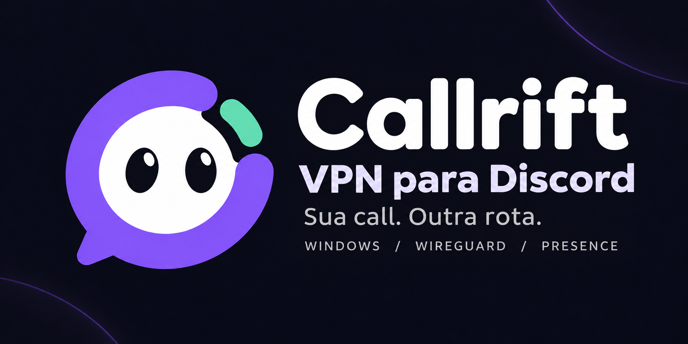
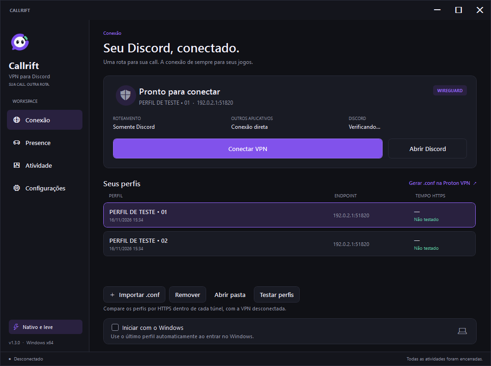
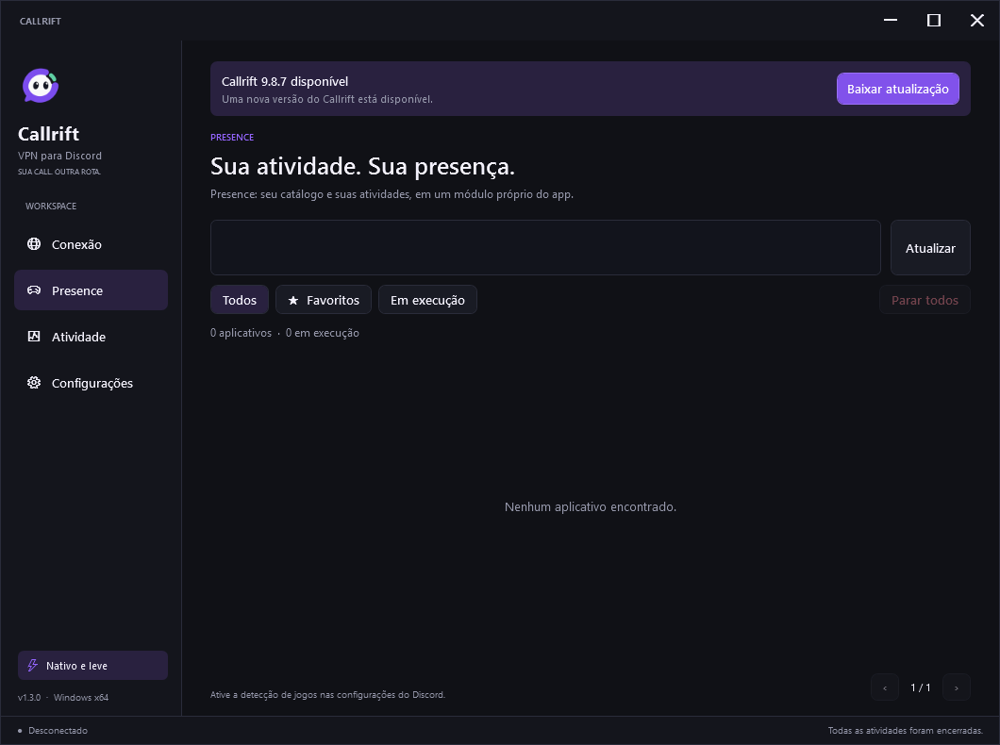

<h1 align="center">Callrift — VPN para Discord + Presence</h1>

<p align="center">
  
</p>

<p align="center">
  Sua call. Outra rota. VPN e Presence em um app nativo para Windows.
</p>

<p align="center">
  <a href="../../releases/latest">Baixar para Windows</a> ·
  <a href="docs/USAGE.md">Guia de uso</a> ·
  <a href="../../issues">Reportar um problema</a>
</p>

## Sua call tem uma rota própria

O Callrift envia o tráfego do Discord pela VPN e mantém os outros aplicativos na saída direta. Importe um arquivo WireGuard da Proton VPN, escolha o perfil e conecte. O Presence reúne catálogo de atividades, busca, favoritos e controles para iniciar ou encerrar a presença no Discord.

A interface usa WPF e componentes nativos do Windows. Sem navegador embarcado, sem login do Discord e sem telemetria.

<p align="center">
  
</p>

*Captura da versão 1.3.0 com perfis de demonstração.*

## Começar a usar

Você precisa de **Windows 10 ou 11 x64**, **.NET Framework 4.8**, Discord desktop e um arquivo WireGuard `.conf` gerado na sua conta Proton VPN.

1. Em [Releases](../../releases/latest), baixe **`Callrift-Setup-1.3.0.exe`** para instalar. Ele cria o atalho no menu Iniciar e aparece na lista de aplicativos do Windows. O atalho na área de trabalho é opcional.
2. Abra o Callrift pelo menu Iniciar. Se preferir usar sem instalar, baixe **`Callrift-1.3.0-Windows-x64.zip`**, extraia a pasta inteira e abra `Callrift.exe`. Mantenha `engine` e `ActivityHost.exe` junto dele.
3. Clique em **Gerar .conf na Proton VPN**. Na Proton, abra **Downloads → WireGuard configuration**, escolha um servidor e baixe o arquivo. Veja o [guia oficial da Proton](https://protonvpn.com/support/wireguard-configurations).
4. Use **Importar .conf**, selecione o perfil e clique em **Conectar VPN**. O Windows pedirá autorização para criar o túnel.
5. Se o Discord estiver aberto, o Callrift pedirá permissão para reiniciá-lo. Autorizar interrompe a chamada atual e reabre o mesmo canal do Discord com novas conexões.

O instalador e o pacote portátil ainda não têm assinatura de editor. Ao fechar a janela, o app continua na bandeja por padrão. Para desligar a VPN e encerrar as atividades, use **Sair** no menu da bandeja.

## O que você encontra

| Recurso | Como funciona |
| --- | --- |
| VPN por processo | Discord Stable, PTB, Canary e Development usam WireGuard; os demais processos saem diretamente |
| Comparação de perfis | Testa cada túnel separadamente e destaca a melhor resposta HTTPS da rodada |
| Presence | Catálogo do Discord, busca por nome/ID/apelido, favoritos, seleção de executável e várias atividades para conclusão de missões por ORBS |
| Inicialização | Pode conectar o último perfil e abrir o Discord depois de verificar o túnel |
| Aparência | Temas claro e escuro; português, inglês e espanhol |
| Perfis protegidos | Configurações importadas ficam criptografadas pelo Windows para seu usuário |

### Escolher um perfil

Desconecte a VPN e clique em **Testar perfis**. O Callrift faz três requisições HTTPS por perfil e mostra a mediana em milissegundos e quantas responderam. Quanto menor o tempo, melhor a resposta dessa sonda naquele momento. O teste não muda a rota do Windows.

Esse número **não é o ping do jogo ou do Discord**, nem um teste de velocidade. Use-o para comparar seus perfis e confirme o resultado numa chamada.

### Usar o Presence

Abra a aba **Presence**, procure uma atividade e clique em **Iniciar**. Você pode escolher o executável detectável, favoritar itens e gerenciar várias atividades. Ative a detecção de jogos nas preferências do Discord.

O módulo usa auxiliares locais; não baixa nem executa o jogo de verdade. A detecção depende do Discord, e o contador de tempo não garante missões ou recompensas.

<details>
<summary>Ver a aba Presence</summary>



</details>

## Antes de conectar

Os jogos usam a saída direta, mas o adaptador virtual também classifica seu tráfego localmente. Isso pode ter custo de processamento; não há promessa de impacto zero. O DNS do Windows é preservado.

Esta versão **não tem kill switch nem reconexão automática**. Se o túnel cair ou o app for encerrado, o Discord pode usar a conexão normal. Discord no navegador e clientes alternativos não fazem parte das regras. A disponibilidade de funções do Discord depende da conta, da plataforma e da rota utilizada.

## Atualizar

Ao abrir, o Callrift consulta as releases públicas de **[tznOG/Callrift](https://github.com/tznOG/Callrift)**. Se houver uma versão estável mais recente com download compatível, aparece um aviso com **Baixar atualização**. A versão instalada oferece o instalador; a portátil oferece o ZIP. A consulta acontece em segundo plano e falhas de rede não impedem o uso.

Você pode adiar a atualização, verificar manualmente ou desativar a consulta automática em **Configurações → Atualizações**. O botão abre o download no GitHub; nada é instalado automaticamente. Quem usa uma versão anterior à 1.3.0 precisa atualizar uma vez para começar a receber os avisos.


Saia da versão antiga pela bandeja antes de executar o novo instalador ou substituir os arquivos da pasta portátil. O instalador atualiza no mesmo local e preserva os dados. Desinstalar pelo Windows também preserva perfis e favoritos. Quem usava **Discord VPN** mantém os perfis, favoritos e preferências: o diretório de dados continua em `%LOCALAPPDATA%\DiscordVPN` por compatibilidade.

Se usava **Iniciar com o Windows**, desative a opção na versão antiga e ative no Callrift, pois o nome do executável mudou. Faça o mesmo sempre que mover a pasta do app. Para abrir o Discord somente após a conexão, desative a inicialização automática do próprio Discord.

## Compilar

No PowerShell, a partir da raiz do projeto:

```powershell
powershell -NoProfile -ExecutionPolicy Bypass -File build.ps1
powershell -NoProfile -ExecutionPolicy Bypass -File tests/Run-Tests.ps1 -Network
```

O build do aplicativo usa o compilador do .NET Framework; não exige Node, Rust ou SDK .NET. O instalador usa uma cópia portátil do Inno Setup, baixada e verificada automaticamente. Baixa sing-box e Wintun de fontes oficiais, em versões fixas e com verificação SHA256. O executável fica em `dist/Callrift`.

Para gerar o instalador, o ZIP portátil e os checksums:

```powershell
powershell -NoProfile -ExecutionPolicy Bypass -File scripts/Package-Release.ps1
```

Consulte o [guia completo](docs/USAGE.md), a [validação](docs/VALIDATION.md), as [notas de versão](CHANGELOG.md) e as [instruções de contribuição](CONTRIBUTING.md).

## Créditos e licença

O Callrift é um projeto independente, sem afiliação com Discord, Proton VPN ou WireGuard. Seu código está sob a [licença MIT](LICENSE). Os componentes distribuídos mantêm suas próprias licenças.

O Presence mantém neste repositório funções adaptadas do [Disactivity, de holasoyender](https://github.com/holasoyender/disactivity), com os [créditos MIT preservados](licenses/Disactivity-MIT.txt). Não é necessário instalar o aplicativo original. O túnel usa [sing-box](https://github.com/SagerNet/sing-box) e [Wintun](https://www.wintun.net/). Consulte os [avisos de terceiros](THIRD-PARTY-NOTICES.md).
